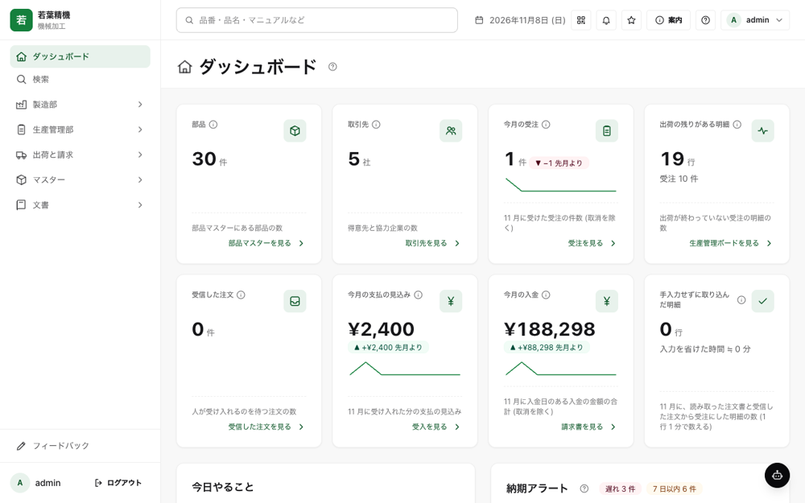
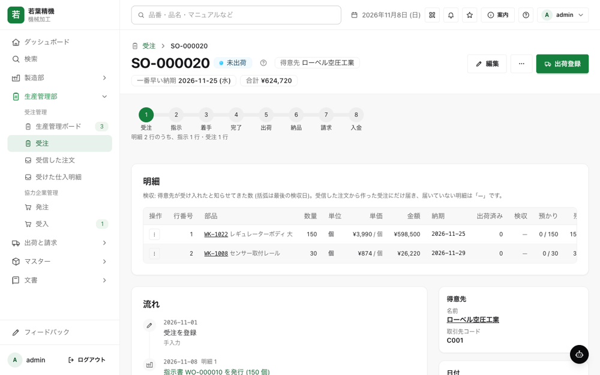
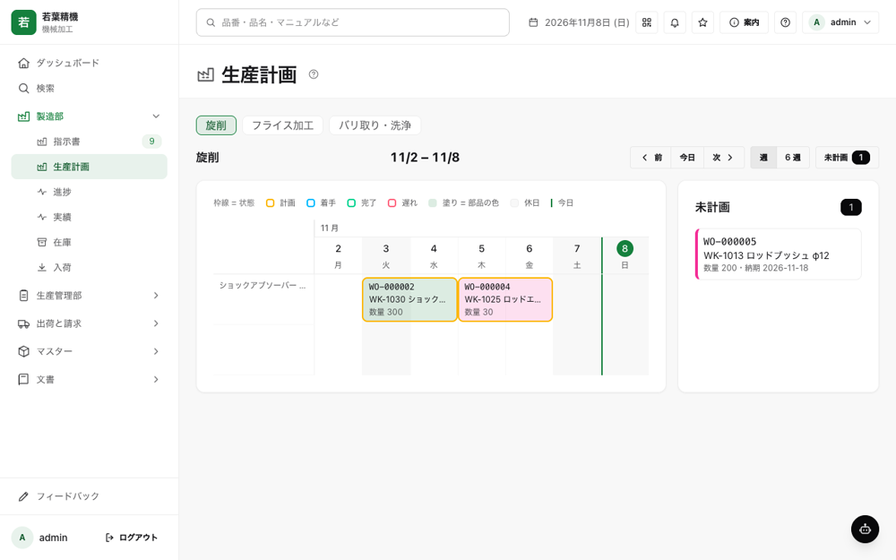
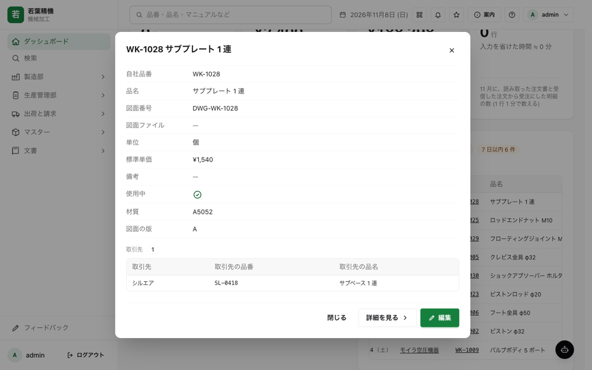
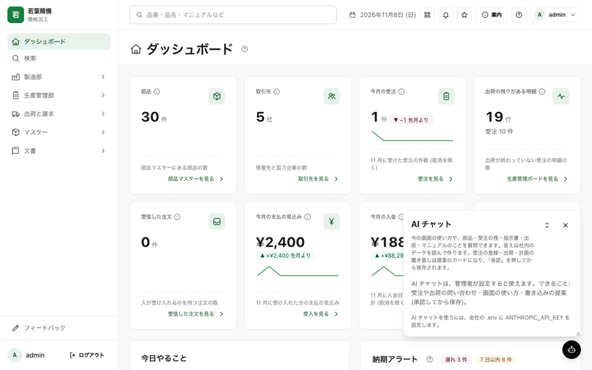
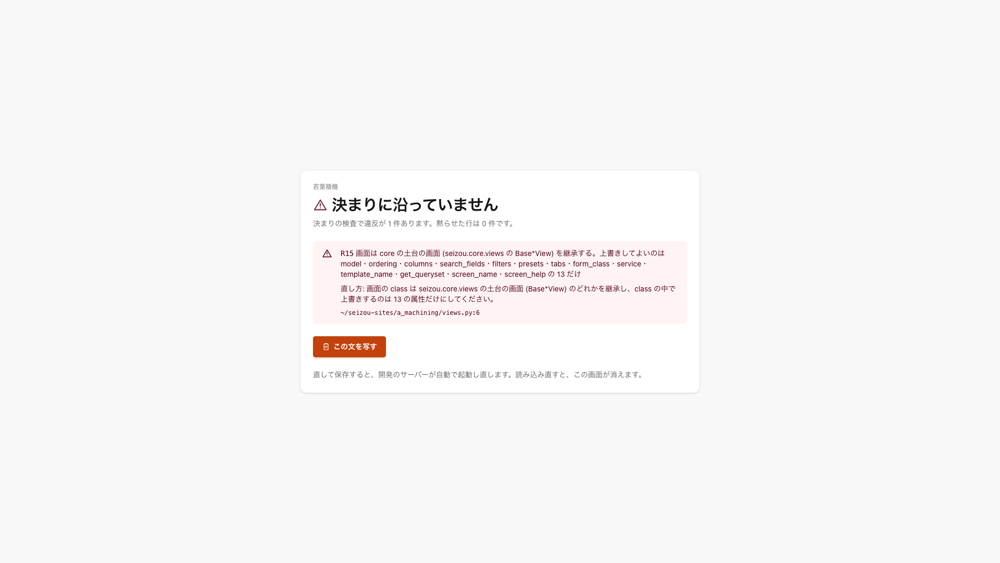

# /seizou

[](https://github.com/kishii-py/seizou/actions/workflows/sqlite.yml) [](https://github.com/kishii-py/seizou/actions/workflows/windows.yml) [](https://pypi.org/project/seizou/) [](LICENSE)

町工場や中小の製造業が、1 つの命令で自社専用のシステムを持ち、部品マスターを中心に社内の情報を 1 つにつなぎ、同じ仕組みで会社どうしもつながる。

seizou は、そのための公開の部品 (OSS。Apache-2.0)。受注から出荷・納品書・請求書までの生産管理と、取引先との注文の送り合いが、日本語の画面で動く。動かす人は、工場の中で Excel と PC を任された 1 人。プログラムは書けなくてよい。

まず試すなら、下の[「試す」](#試す)の命令で、手元の PC に作り物の 2 社を立てる。

/seizou は Claude Code のプラグインの命令の名前で、GitHub のリポジトリと pip で入れる部品の名前は seizou。

Claude Code のプラグインと、pip で入れる Django の部品を、この 1 つのリポジトリに置く (Apache-2.0)。

seizou: with one command, a small or mid-sized manufacturer gets a business system built for its own way of working.
The item master sits at the center and connects information across the company, and companies running seizou can exchange orders with each other.
It is made for the one person in the factory who looks after Excel and the PC, with no programming needed. First release v0.1.0 (November 2026); the UI and documents are in Japanese.

## 画面の絵

作り物の A 社 (若葉精機) を `seizou new --demo` で立て、管理者でログインして 1280 幅で撮った物 (11-08)。データは全部作り物。

| | |
|---|---|
|  ダッシュボード (部品・取引先・今月の受注・出荷の残りと、今日やること) |  受注の詳細 (受注から入金までの段・明細・流れ) |
|  生産計画の盤 (工程ごとの週の計画と未計画) |  どの画面からも小窓で開く部品マスター |
|  AI チャットの窓 (画面と同じ決まりを通して読み書きする) |  会社が足した画面が決まりを外れたときの全面の知らせ (番号・ファイル・行・直し方) |


## できること

- 受注から請求まで: 受注・指示書・進捗・出荷・納品書・請求書・発注・受入・在庫が、部品マスターの品番を軸に画面でつながる。生産計画の盤、図面と添付ファイル、QR 付きの現品票、業務マニュアルもある ([画面の一覧と業務の流れ](docs/screens.md))。
- 注文書の読み取り: 注文書の PDF や画像を AI が読み、人が確かめてから受注にする (作り物の 1 枚で約 2.6 円の実測)。部品と取引先は、Excel の Shift_JIS のままの CSV で取り込める。
- 会社ごとの形: 会社ごとの項目を本物の列として足し、分納を許すか、受注より多い出荷を止めるか、などを設定で選ぶ ([会社ごとの設定](docs/settings.md))。
- 取引先とつなぐ: 受注と発注の項目は、中小企業共通 EDI の項目を元にした。seizou を入れた会社どうしなら、注文・注文回答・出荷の知らせを同じ仕組みで送り合う ([取引先とのつながり](docs/connect.md))。
- お金と数の決まり: 受注より多い出荷を止めるような決まりを [RULES.md](RULES.md) に番号つきで並べ、番号ごとに自動テストで守る。お金と数の決まりを破る変更は本番の前に止まる ([決まりと権限](docs/rules.md))。
- Claude Code から: `/seizou:build` の 3 つの問いに答えると会社のシステムが立つ。立てた後は、手元の Claude Code から受注・出荷・指示書などを読める ([プラグインと MCP](docs/plugin.md))。

相手の会社が seizou を入れていなくても、注文書の読み取り・CSV の取り込み・社内の情報が部品マスターを軸に 1 つの形になること、の 3 つは自社だけの得になる。

## 試す

手元の PC に作り物の 2 社 (機械加工の若葉精機と、表面処理の白樺めっき工業) を立てて、受注から請求書までと、2 社の間の注文の送り合いを画面で通せる。要る物は `git` と `uv`。

```sh
git clone --branch v0.1.0 https://github.com/kishii-py/seizou.git
cd seizou
uv sync --locked
uv run seizou new examples/companies/a_machining.yaml --demo
uv run seizou new examples/companies/b_plating.yaml --demo
```

`seizou new` が終わりに出す起動の 1 行を打ち、ブラウザで開く (A 社は http://127.0.0.1:8001/ 、B 社は http://127.0.0.1:8002/ )。見る順と手順は [docs/getting-started.md](docs/getting-started.md) の「触り方」にある。作り物の 3 人 (`genba`・`jimu`・`keiri`) の ID と合言葉も、同じ「触り方」にある。Claude Code を使う方は、[docs/plugin.md](docs/plugin.md) の `/seizou:build` でも立てられる。

- Windows は PowerShell を開き、上の 5 行を 1 行ずつ打つ (uv の入れ方は [docs/getting-started.md](docs/getting-started.md) の「前提」)。
- 今ある入れ方は、端末で命令を打つ方法だけ。作者の手元 (macOS) で通した物で、Linux と Windows は、入れる所から画面が開くまでを CI で通している (人の手で通した確認と、日本語の Windows の実機での確認はまだ無い)。
- ソフトは無料。AI の機能 (注文書の読み取り・AI チャット・フィードバックの聞き取り) を使う会社だけ、Anthropic の API の鍵 (`ANTHROPIC_API_KEY`) と、読んだ分の費用が要る。鍵が無くても、ほかの画面は動く。

## 今の状態

版は v0.1.0 (2026-11-08)。冒頭の 1 文の 3 つの句 (1 つの命令で自社専用・部品マスターを中心に社内の情報を 1 つに・同じ仕組みで会社どうしもつながる) は、手元の 2 社でも、VPS に https で立てた離れた 2 社でも、画面で通る (句ごとの状態は [docs/roadmap.md](docs/roadmap.md))。

本番の前に残る物は 6 つ (2026-11-08 の時点)。

1. Linux と Windows で手で通した確認 (今は CI だけ。2026-11-11 から、入れる所から画面が開くまでを CI が ubuntu・windows・macos で通している。日本語の Windows の実機はまだ)
2. PostgreSQL の実機の置き場 (VPS の 2 社は SQLite で立てている。控えから入れ直す手順もこれから)
3. Claude Security の未走査の部品 (出荷・発注・フィードバック・プラグイン) の走査
4. 部品の版を上げた実例 (今は v0.1.0 の 1 版だけ。出した migration を消さない決まりと試験はある)
5. 置き場を立てる命令と、公開の URL を持たない会社のための中継
6. 2 段階の確認 (ログインのときの 2 要素認証)

本番で使うときの決まりは [docs/production.md](docs/production.md)、これから作る物は [docs/roadmap.md](docs/roadmap.md) にある。

## 誰の何のため

社内では部署ごとに情報が分かれ、担当者の頭の中にしかない。会社の間では取引先ごとに項目と書式が違い、その違いを人が覚えて吸収している (作者の見方)。作者が働いていた表面処理の工場では、多い日に 1 日 70 件の注文を受け、月 1,400 枚の伝票を手で入れていた。

seizou は、会社ごとの項目を本物の列として足し、向き不向きの分かれる動きを設定で選び、同じ仕組みを入れた会社どうしで同じ形のまま送り合う。背景と、既にある道具との違いは [docs/why.md](docs/why.md) に書いた。

## 一緒に育てる

この仕組みを一緒に育てる仲間を探している。Issue と PR を受け付けている。

- 使う会社の方: 上の「試す」で作り物の 2 社を触り、困りごとや要望を、画面の「フィードバック」か GitHub の Issue で伝えてほしい。プログラムを書かない方の、決まりの提案と反例が貢献の芯になる ([CONTRIBUTING.md](CONTRIBUTING.md))。
- 直す開発者の方: [RULES.md](RULES.md) (決まりの一覧。R01〜R27) と [CONTRIBUTING.md](CONTRIBUTING.md) (受け入れの条件と Issue の型) を読んでほしい。手元で確かめる命令は [docs/development.md](docs/development.md) にある。

運営の決まりは [GOVERNANCE.md](GOVERNANCE.md)、安全上の問題の報告先は [SECURITY.md](SECURITY.md)、版ごとの変更は [CHANGELOG.md](CHANGELOG.md) にある。

## 文書

| 文書 | 中身 |
|---|---|
| [docs/getting-started.md](docs/getting-started.md) | 前提と触り方 (入れて、作り物の 2 社で受注から請求までと注文の送り合いを通す) |
| [docs/screens.md](docs/screens.md) | 画面の一覧と業務の流れ |
| [docs/settings.md](docs/settings.md) | 選べる設定 |
| [docs/connect.md](docs/connect.md) | 取引先とつなぐ仕組みと、社内の 1 つの形 |
| [docs/rules.md](docs/rules.md) | 決まりを守る仕組みと、アカウントごとの使える範囲 |
| [docs/plugin.md](docs/plugin.md) | Claude Code のプラグインと MCP |
| [docs/production.md](docs/production.md) | 本番の決まりと毎日の運用 |
| [docs/operations.md](docs/operations.md) | 控え・戻し・点検・版を上げる手順 |
| [docs/vps.md](docs/vps.md) | VPS 1 台に 2 社分を立てて、https で取引先とつなぐ手順 |
| [docs/intake-watch.md](docs/intake-watch.md) | フォルダに置いた注文書を読み取り、受信した注文に並べる手順 |
| [docs/edi-items.md](docs/edi-items.md) | 会社どうしで送り合う項目の表 |
| [docs/denchoho.md](docs/denchoho.md) | 電子取引のデータの保存 (電子帳簿保存法) |
| [docs/roadmap.md](docs/roadmap.md) | 今の状態とこれからの道筋 |
| [docs/why.md](docs/why.md) | 誰の何のため・既にある道具との違い |
| [docs/development.md](docs/development.md) | 開発する人へ (試験・検査・E2E) |
| [docs/hackathon.md](docs/hackathon.md) | Built with Claude: Japan 2026 の記録 (どう作ったか・会期中に作った量) |

## ライセンス

Apache-2.0 (LICENSE)。著作権の表示は NOTICE。
同梱する外の物 (CSS・JS・フォント) と Python の依存のライセンスは、THIRD_PARTY_NOTICES.md にまとめる。
